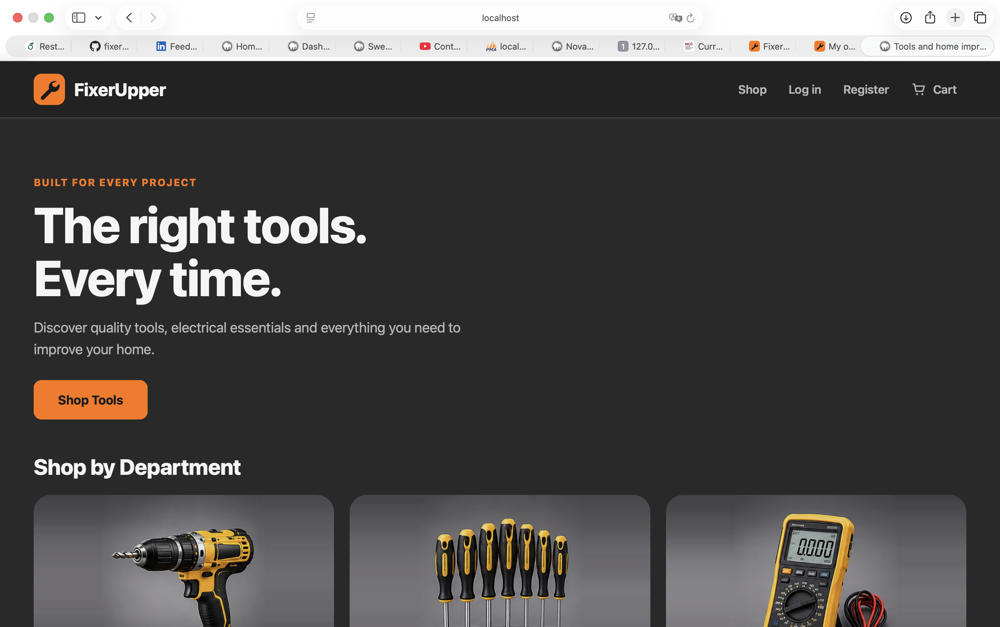
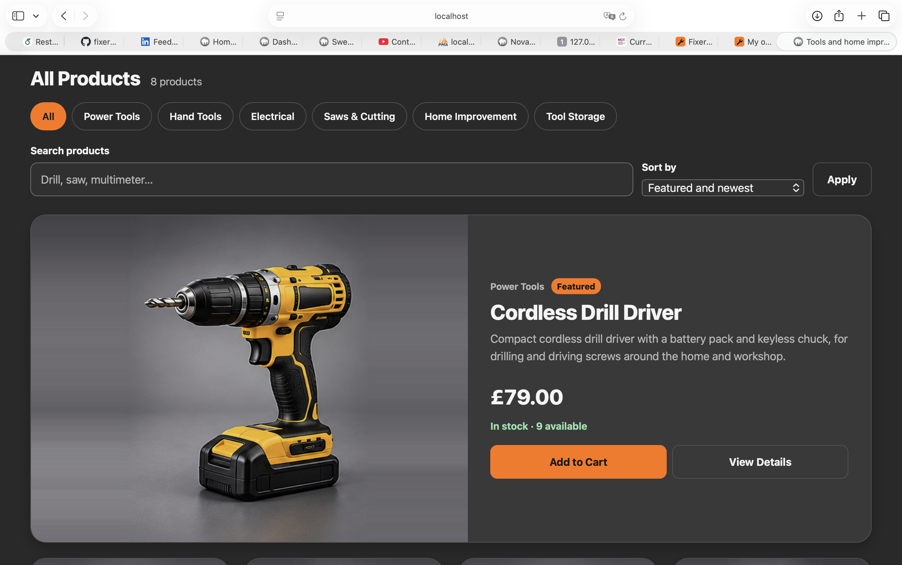
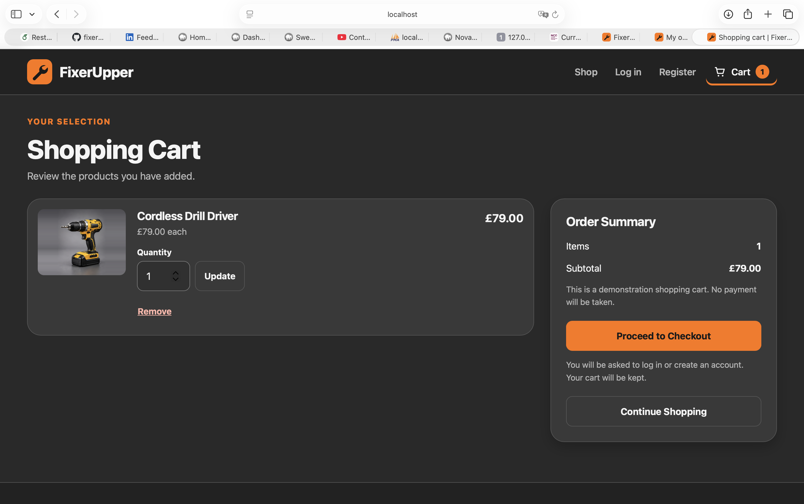
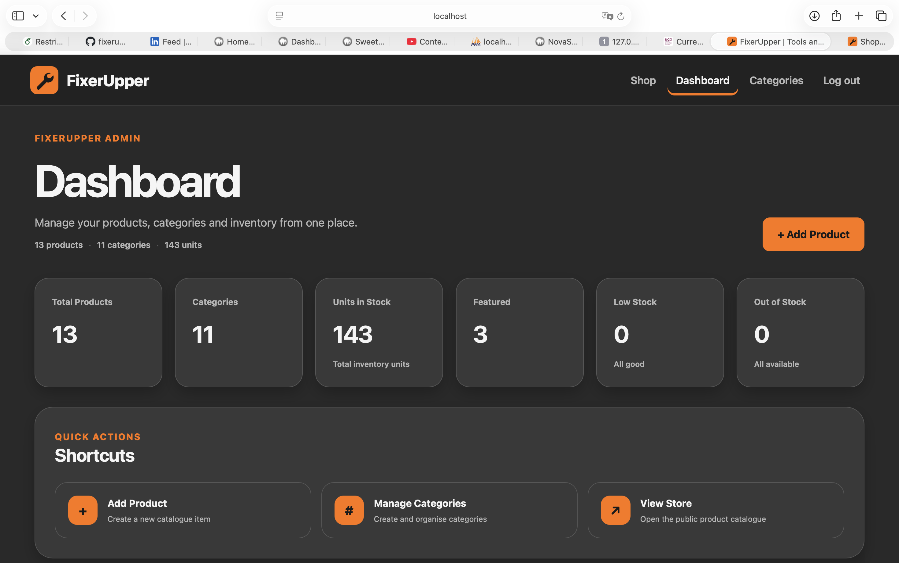

# 🔧 FixerUpper — Secure E-Commerce Web Application

A responsive e-commerce demonstration application developed using PHP, MySQL, JavaScript, HTML and CSS.

Built as part of the **CMP214 Secure Website Development** module during my FdSc Computing studies.

The project demonstrates full-stack web development, customer authentication, product management, order processing and secure coding practices.

> **Disclaimer:** This is an educational demonstration store. No real payments are processed or orders fulfilled.

---

## 📸 Project Screenshots

### Homepage



### Product Catalogue



### Shopping Cart



### Administration Dashboard



---

## 🚀 Features

### Customer Features

- Responsive product catalogue
- Product search, category filtering and sorting
- Product details and stock availability
- Shopping cart with quantity management
- Customer registration and login
- Checkout with collection and delivery options
- Order confirmation and reference generation
- Customer order history

### Administration Features

- Separate administrator login
- Dashboard with inventory statistics
- Add, edit and delete products
- Product category management
- Stock and availability tracking
- Featured product management
- Product image management

---

## 🔐 Security Features

The application implements several security measures, including:

- PDO prepared statements for database operations
- Password hashing and verification
- CSRF protection for applicable forms
- Server-side input validation
- Role-based access control
- Session management
- Restricted access to sensitive directories
- Generic user-facing error messages
- Local database credentials excluded from Git

These measures demonstrate secure development practices. They do not constitute an independent security audit.

---

## 🛠️ Tech Stack

| Technology | Purpose |
|------------|---------|
| PHP | Server-side application logic |
| MySQL | Relational database |
| PDO | Secure database interactions |
| JavaScript | Client-side functionality |
| HTML5 | Page structure |
| CSS3 | Responsive interface |
| Apache / MAMP | Local development environment |
| Git & GitHub | Version control |

---

## 💻 Local Installation

### Requirements

- PHP with PDO MySQL support
- MySQL
- Apache or a compatible PHP web server
- MAMP or an equivalent local environment

### Installation Steps

1. Clone the repository:

```bash
git clone https://github.com/ben-ekay/fixerupper-secure-store.git
```

2. Place the project in your local server's document root, or configure a symbolic link.

3. Copy the database configuration template:

```bash
cp config/db.example.php config/db.php
```

4. Edit `config/db.php` with your local MySQL credentials.

5. Import `database/install.sql` into MySQL using phpMyAdmin or the MySQL command-line client.

6. Start your local Apache and MySQL servers.

7. Open the project through your configured localhost address.

For the default MAMP Apache port and the project folder name used during development:

```text
http://localhost:8888/fixerupper-secure-store/
```

The installer creates a demonstration database named `fixerupper_summative`.

Administrator credentials must be configured locally. No production credentials are included in the repository.

---

## 🧪 Functional Testing

The following workflows were manually tested in a local MAMP environment:

| Functionality | Result |
|---------------|--------|
| Homepage and product catalogue | Passed |
| Product details and shopping cart | Passed |
| Customer registration | Passed |
| Checkout and order confirmation | Passed |
| Customer order history | Passed |
| Administrator login | Passed |
| Administration dashboard | Passed |
| Create product | Passed |
| Update product | Passed |
| Delete product | Passed |
| PHP syntax checks | Passed |

Additional automated and security testing would be required before production deployment.

---

## 📚 Learning Outcomes

Through this project, I developed practical experience in:

- Building dynamic applications with PHP and MySQL
- Designing relational database-backed workflows
- Implementing customer and administrator authentication
- Applying secure coding principles
- Developing CRUD functionality
- Managing sessions and user roles
- Testing and debugging web applications
- Using Git branches and pull requests

---

## 🎯 Project Status

**Academic project — functional local demonstration**

Developed and tested locally as part of CMP214 Secure Website Development.

This application is intended for educational and portfolio purposes, not production commercial use.

---

## 👨‍💻 Author

**Benjamin Ekay**

FdSc Computing Student | Aspiring Software Developer

London, United Kingdom

[GitHub Profile](https://github.com/ben-ekay)
